<div align="center">


# Orbit

### Every lesson, aimed at your future.

A **Smart Education & Career Ecosystem** for students, fresh graduates and job seekers.<br/>
Orbit connects what you learn in class to the skills, roadmap and opportunities of the career you want.

<br/>

[](https://orbit-career-agent.vercel.app)
[](#-theme--sdg-4)
[](#-theme--sdg-4)


[🇮🇩 Bahasa Indonesia](README.md) · **🇬🇧 English**

<br/>

<picture>
  <source media="(prefers-color-scheme: dark)" srcset="assets/screenshots/en/dark/01-landing.png" />
  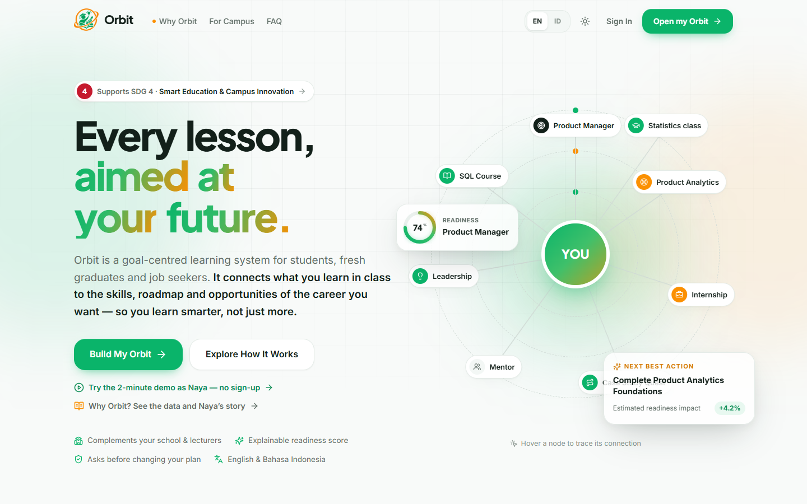
</picture>

</div>

---

## 📑 Contents

[About](#-about-orbit) · [Theme & SDG 4](#-theme--sdg-4) · [Problem](#-the-problem) · [Solution](#-solution-orbits-6-pillars) · [Try It](#%EF%B8%8F-try-it-in-2-minutes) · [Screens](#%EF%B8%8F-screens) · [Impact](#-impact--kpi-targets) · [Tech](#%EF%B8%8F-tech-stack) · [Run Locally](#-run-locally) · [Structure](#-project-structure)

---

## 🧭 About Orbit

Many learners spend years studying without knowing **what it is for**. Orbit answers two simple questions:

> **"How ready am I for my dream career, and what should I learn next?"**

Orbit reads your learning materials, maps every class to the skills and careers it powers, then builds a roadmap, weekly quests and the most relevant opportunities. The result: you learn **smarter and with purpose**, not just more.

| | |
| --- | --- |
| 🎯 **Who it's for** | High school and vocational students, university students, fresh graduates, job seekers, plus campuses and lecturers |
| 🧩 **What's different** | One place to learn, plan and grow, all aimed at one career goal |
| 🔍 **Explainable** | Every score and recommendation comes with a clear reason, never a black box |
| 🤝 **You decide** | Orbit proposes; any change to your plan always asks for your confirmation |
| 🔒 **Private** | No required sign-up and no server. Data stays in your browser; learning files are analysed on-device and never uploaded |

---

## 🎓 Theme & SDG 4

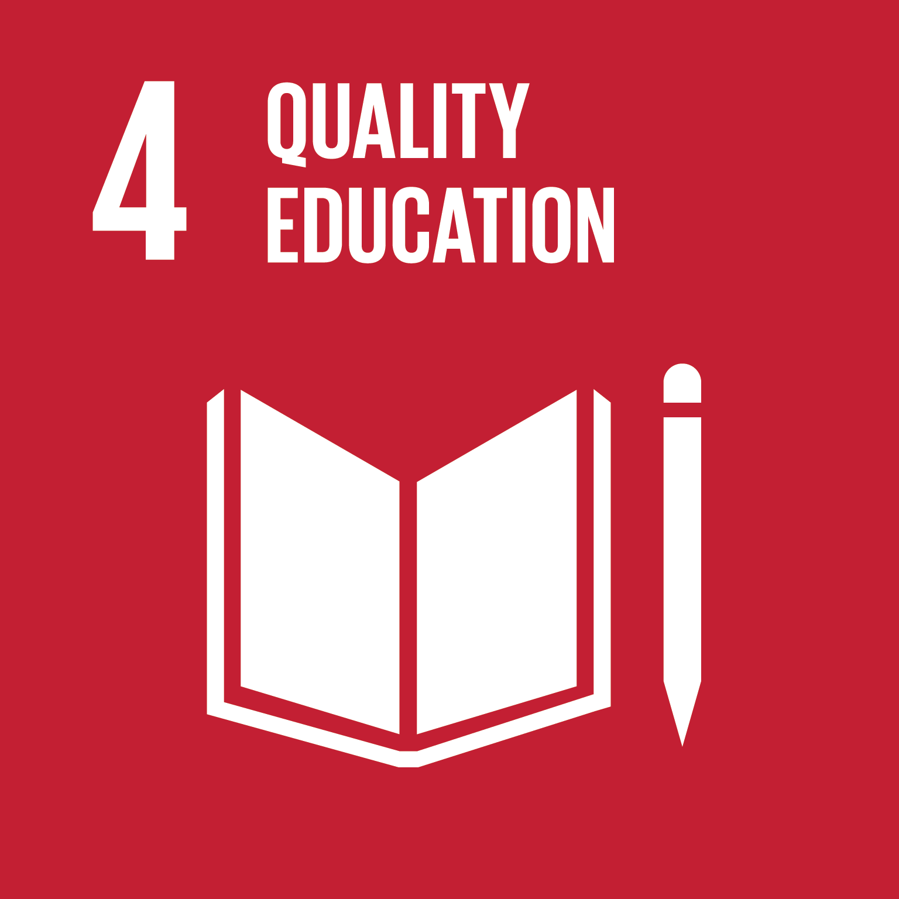

**INVOFEST 2026 · Web Design**<br/>
Theme: *Smart Ecosystems: Digital Solutions for a Sustainable Future*<br/>
Subtheme: **Smart Education & Campus Innovation (SDG 4)**

Orbit **does not replace** schools, campuses or lecturers. It **complements** them: lecturers teach, Orbit shows where each lesson leads. For institutions, **Orbit for Campus** gives aggregate insight into student readiness and skill gaps, so advising and curriculum can be better targeted.

| SDG target | Orbit's contribution |
| --- | --- |
| **4.3** Access to quality education | Free learning and career guidance, anytime |
| **4.4** Relevant skills for decent work | Every class mapped to real job demand |
| **4.5** Fewer disparities | Bilingual (EN/ID), mobile-first, no cost |

Orbit also supports **SDG 8.6** (fewer youth not in work, education or training) and **SDG 10.2** (career guidance no longer depends on who you know).

---

## ❗ The Problem

Indonesia has **7.38 million unemployed people** (BPS, August 2026), and **more than 5 million** of them already finished high school, vocational school or university.

| Data | What it means |
| --- | --- |
| **9.9M** young people (15–24) are not in work, school or training | Many stop because they lack direction |
| **87%** of students feel their major doesn't match their interests | Years of study without knowing why |
| **±35%** of young workers hold jobs that don't match their education | What is learned and what work needs never meet |
| **8.20%** unemployment among SMK graduates, the highest of any level | Education isn't linked tightly enough to industry |
| **39%** of core skills will change by 2030 | Learners need a compass that keeps up |

<sub>Sources: [BPS via Katadata](https://databoks.katadata.co.id/ketenagakerjaan/statistik/6aec350368270/ada-738-juta-pengangguran-di-indonesia-pada-agustus-2026) · [BPS via CNBC Indonesia](https://www.cnbcindonesia.com/news/20261106084938-4-782835/880-ribu-sarjana-ri-masih-menganggur) · [BPS NEET](https://www.cnbcindonesia.com/research/20240515103217-128-538210/10-juta-gen-z-di-ri-nganggur-sekolah-kagak-kerja-kagak-maunya-apa) · [Indonesia Career Center Network](https://www.goodnewsfromindonesia.id/2022/04/01/penyebab-fenomena-salah-jurusan) · [CNBC Research](https://www.cnbcindonesia.com/research/20251104154304-128-682220/pendidikan-tinggi-upah-rendah-35-pekerja-muda-salah-jurusan) · [Fortune IDN](https://www.fortuneidn.com/news/provinsi-dengan-tingkat-pengangguran-tertinggi-2026-versi-bps-d7w02-00-lflgw-1qgths) · [WEF Future of Jobs 2025](https://www.weforum.org/publications/the-future-of-jobs-report-2025/)</sub>

**Meet Naya**, an Information Systems student who dreams of becoming a Product Manager. Her GPA is good, but she doesn't know which classes matter, follows whatever her friends learn, gets overwhelmed hunting for internships, loses motivation, then panics in her final year. The **[Why Orbit](https://orbit-career-agent.vercel.app/why-orbit)** page tells her full story.

---

## 💡 Solution: Orbit's 6 Pillars

The flow is simple: **Dream → Learn → Plan → Grow**.

| # | Pillar | Feature | What it does |
| --- | --- | --- | --- |
| 01 | **Start** | Build My Orbit | Three short steps (profile, career goal, skills), then your first career analysis on the spot |
| 02 | **Understand** | Career Intelligence | A 0–100% Career Readiness score across 6 dimensions, with strengths and gaps ranked |
| 03 | **Learn** | Learning Map · Knowledge Vault | Every class mapped to skills and careers. Upload slides, notes, assignments or projects and Orbit finds the skills inside |
| 04 | **Explore** | Career Universe | An interactive map linking you to roles, skills, courses, mentors and openings. More than one dream? Build several orbits |
| 05 | **Plan** | Journey | A phased roadmap and weekly quests (roadmap or kanban board) built from your gaps |
| 06 | **Discover & Grow** | Discover · Today · Progress · Orbit Agent | Internships, jobs, courses, events, mentors and books with a match score. One *Next Best Action* a day, XP, streaks and the Orbit Agent assistant |

**Also included:** Orbit for Campus (campus insight dashboard) · Career Journal · notifications & reminders · quick search `Ctrl/⌘ + K` · Orbit Agent (`A` key) · light/dark mode · English & Bahasa Indonesia · installable as an app (PWA) · fully responsive on mobile.

---

## ▶️ Try It in 2 Minutes

Open **[orbit-career-agent.vercel.app](https://orbit-career-agent.vercel.app)**, no sign-up needed.

1. **Why Orbit:** see the data, Naya's story, then the 6 solution pillars. Each pillar has a button that opens the feature directly, and the back button returns you to where you were on the page.
2. **Try the demo as Naya:** from the home page, or *Continue with Naya's demo account* on the Sign in page.
3. **Today:** follow the *Start here* guide (Dream → Learn → Plan → Grow).
4. **Learn:** add a learning material, see the skills Orbit finds, then open the Learning Map to see what each class is for.
5. **Career Universe:** click *Product Analytics* → **Add to Journey** → confirm.
6. **Journey & Discover:** move a quest on the board, save an internship and set a reminder.
7. **Orbit Agent:** press `A` and ask *"What should I do next?"*

Reset the demo anytime from the account menu → **Reset demo data**.

---

## 🖼️ Screens

<table>
<tr>
<td width="50%">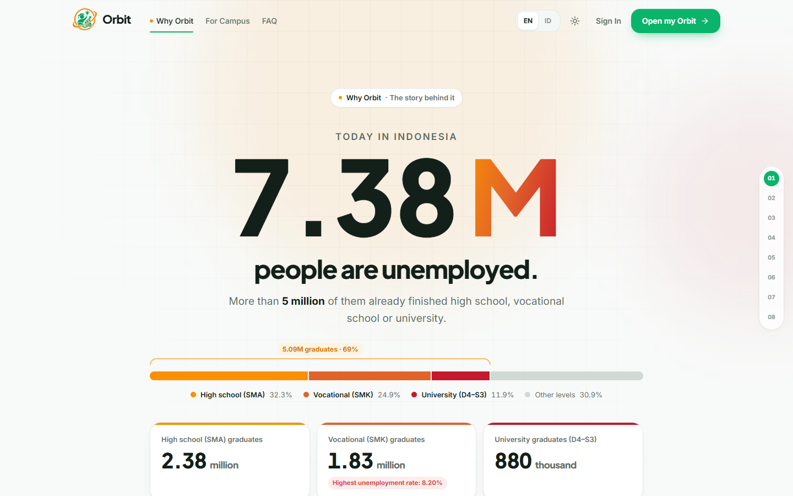<br/><sub><b>Why Orbit:</b> the data, Naya's story and the solution</sub></td>
<td width="50%">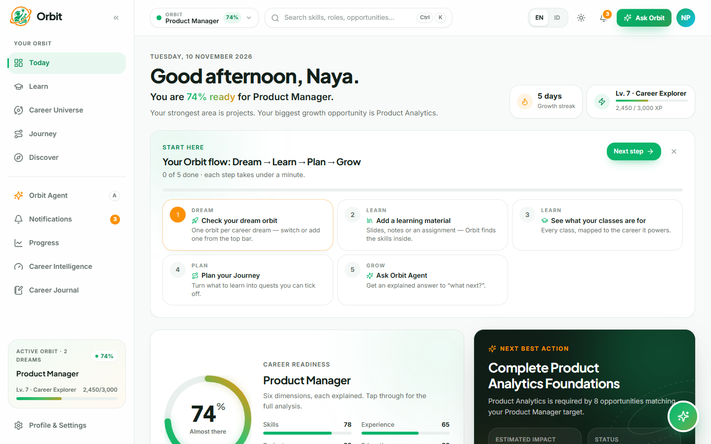<br/><sub><b>Today:</b> step-by-step guide and Next Best Action</sub></td>
</tr>
<tr>
<td>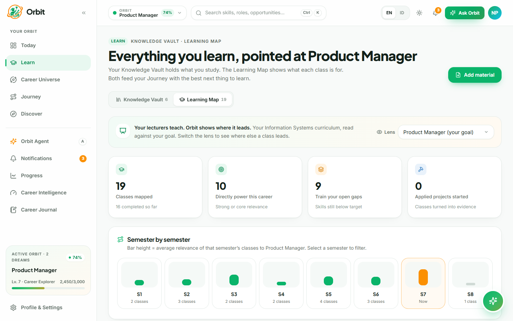<br/><sub><b>Learn:</b> Knowledge Vault & Learning Map</sub></td>
<td>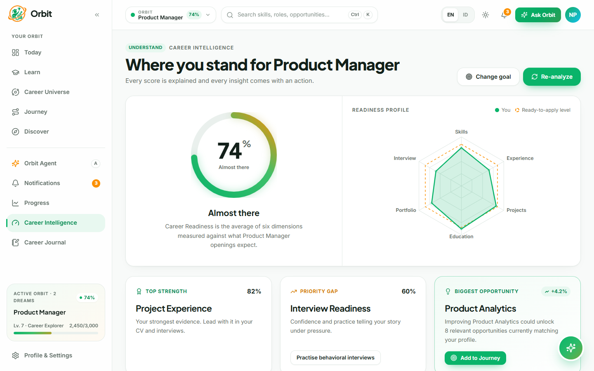<br/><sub><b>Career Intelligence:</b> readiness across 6 dimensions</sub></td>
</tr>
<tr>
<td>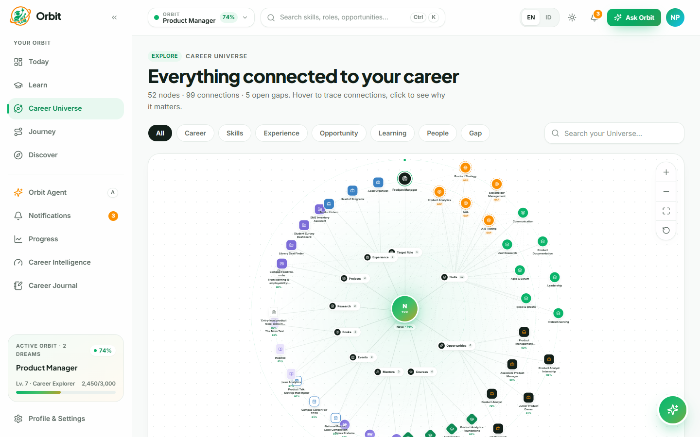<br/><sub><b>Career Universe:</b> everything connected to your career</sub></td>
<td>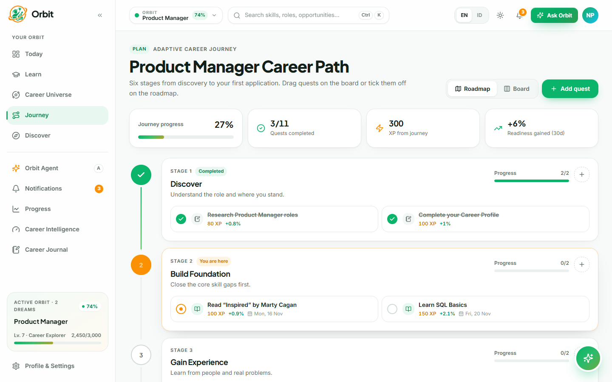<br/><sub><b>Journey:</b> roadmap and weekly quests</sub></td>
</tr>
<tr>
<td>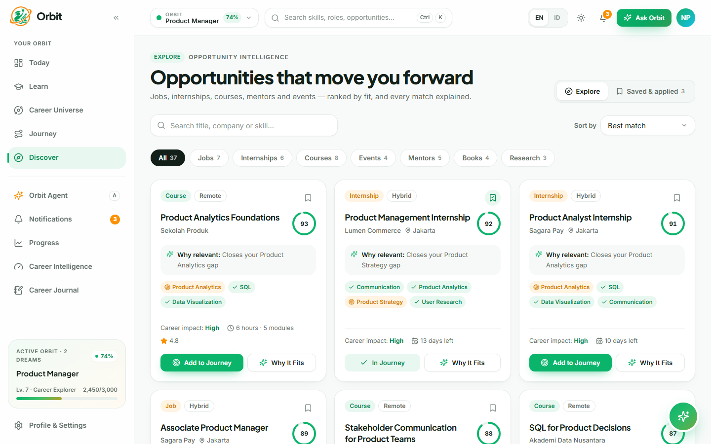<br/><sub><b>Discover:</b> opportunities ranked by fit</sub></td>
<td>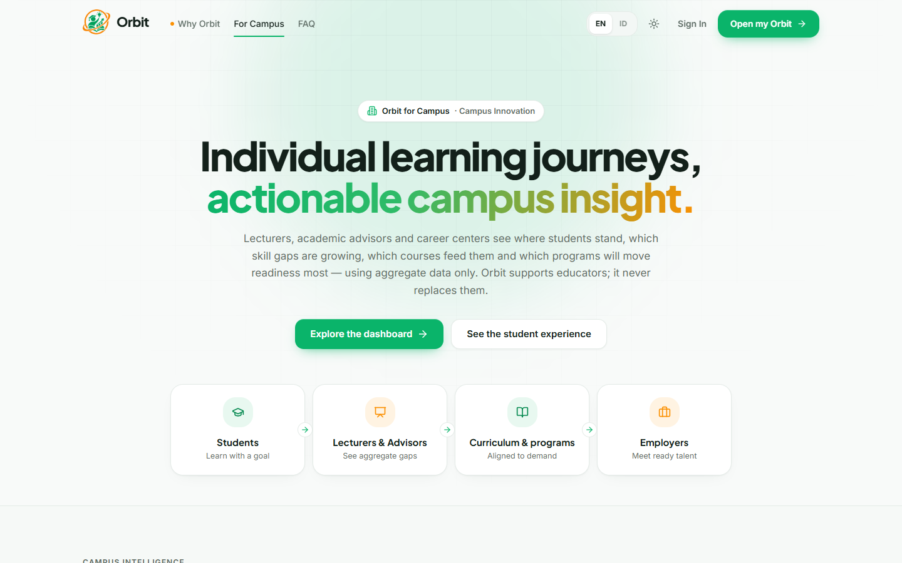<br/><sub><b>Orbit for Campus:</b> insight for campuses and lecturers</sub></td>
</tr>
</table>

<details>
<summary>Dark mode</summary>
<br/>
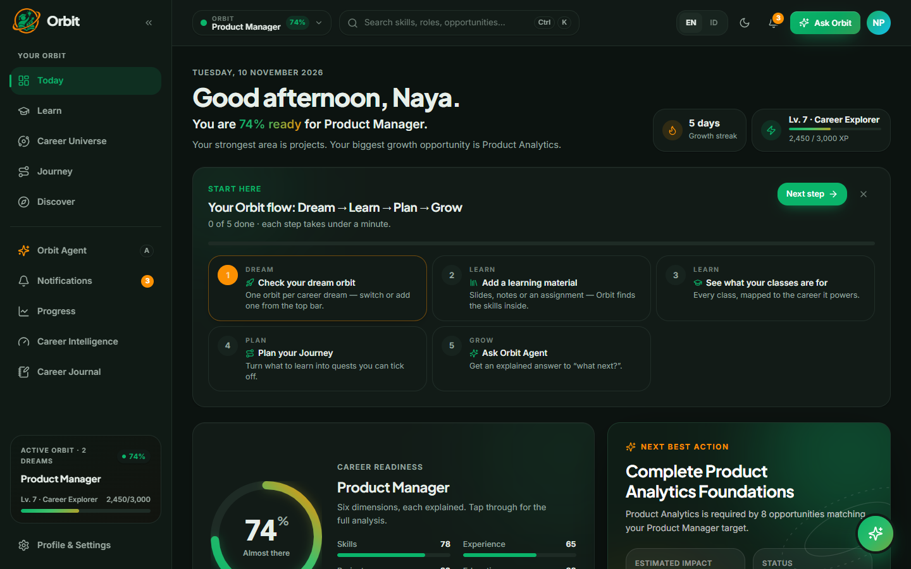
</details>

---

## 📈 Impact & KPI Targets

**Impact chain:** learners study with direction → relevant skills, early → graduates who are ready → fewer educated unemployed.

| Target | Measure |
| --- | --- |
| **+15 points** | Career Readiness per active semester |
| **100%** | Classes mapped to a career reason, from day one |
| **30 min** | Weekly learning plan (down from 3–5 hours) |
| **70%** | Users finish ≥1 quest every week (year 1) |
| **80%** | Learners know why they study each class (year-1 survey) |
| **≤6 months** | To a first job or internship after graduating |

**Scale plan:** Pilot 2027 (10 partners, 10K learners) → Scale 2028 (40 partners, 75K learners) → National 2029 (100 partners, 250K learners).

---

## 🛠️ Tech Stack

| Area | Technology |
| --- | --- |
| **Framework** | React 19, Vite 6, TypeScript, React Router 7 |
| **UI** | Tailwind CSS 4, Radix UI, Lucide Icons, Motion, Lenis |
| **Visualisation** | React Flow (`@xyflow/react`), Recharts, dnd-kit |
| **State & data** | Zustand (persisted to `localStorage`), Zod |
| **Intelligence** | Explainable on-device engines: Career Intelligence, Knowledge, Universe and Orbit Agent (`apps/web/src/engine`) |
| **Other** | PWA (`vite-plugin-pwa`), bilingual EN/ID, deployed on Vercel |

---

## 🚀 Run Locally

Requirements: **Node.js 20+** and **pnpm 9**.

```bash
git clone https://github.com/StyNW7/Orbit-AI-Agent.git
cd Orbit-AI-Agent
pnpm install
pnpm dev        # http://localhost:5173
```

| Command | Purpose |
| --- | --- |
| `pnpm dev` | Start the dev server |
| `pnpm build` | Production build to `apps/web/dist` |
| `pnpm preview` | Preview the build |
| `pnpm lint` · `pnpm typecheck` | Code quality checks |

No database, API key or `.env` file required.

---

## 📁 Project Structure

```
.
├── apps/web/                 # Orbit web app (React + Vite)
│   ├── public/               # Icons & PWA assets
│   └── src/
│       ├── features/         # Pages: landing, why, learning, universe, journey, discover, campus, ...
│       ├── engine/           # Career Intelligence, Knowledge, Universe and Orbit Agent logic
│       ├── data/             # Demo data (Naya persona, courses, opportunities, campus)
│       ├── components/       # UI, layout and Orbit Agent components
│       ├── store/            # App state (Zustand)
│       └── lib/              # i18n, motion, utilities
├── packages/config/          # Shared TypeScript config
├── assets/                   # Logo, SDG 4 icon, README screenshots
├── README.md                 # Bahasa Indonesia
└── README-eng.md             # English
```

---

## 👤 Author

<a href="https://github.com/StyNW7"></a>

**Stanley Nathanael Wijaya** · BINUS University

---

<div align="center">


**Orbit: from learning without direction, to graduates ready to work.**

<sub>Built for INVOFEST 2026 Web Design · Smart Education & Campus Innovation (SDG 4)</sub>

[⬆ Back to top](#orbit)

</div>
