<div align="center">


# Orbit

### Setiap pelajaran, terarah ke masa depanmu.

**Smart Education & Career Ecosystem** untuk siswa, mahasiswa, fresh graduate, dan pencari kerja.<br/>
Orbit menghubungkan apa yang kamu pelajari di kelas dengan skill, roadmap, dan peluang dari karier yang kamu inginkan.

<br/>

[](https://orbit-career-agent.vercel.app)
[](#-tema--sdg-4)
[](#-tema--sdg-4)


**🇮🇩 Bahasa Indonesia** · [🇬🇧 English](README-eng.md)

<br/>

<picture>
  <source media="(prefers-color-scheme: dark)" srcset="assets/screenshots/id/dark/01-landing.png" />
  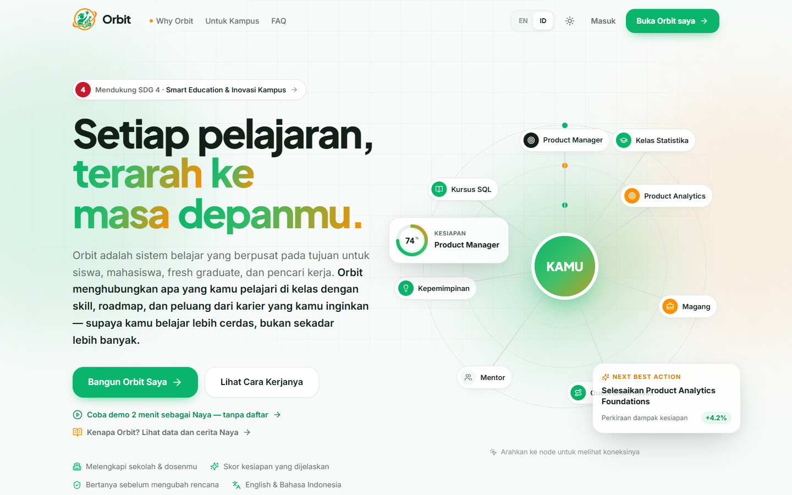
</picture>

</div>

---

## 📑 Daftar Isi

[Tentang Orbit](#-tentang-orbit) · [Tema & SDG 4](#-tema--sdg-4) · [Masalah](#-masalah) · [Solusi](#-solusi-6-pilar-orbit) · [Coba Demo](#%EF%B8%8F-coba-dalam-2-menit) · [Tampilan](#%EF%B8%8F-tampilan) · [Dampak](#-dampak--target-kpi) · [Teknologi](#%EF%B8%8F-teknologi) · [Menjalankan Lokal](#-menjalankan-secara-lokal) · [Struktur Folder](#-struktur-folder)

---

## 🧭 Tentang Orbit

Banyak pelajar belajar bertahun-tahun tanpa tahu **untuk apa** pelajaran itu. Orbit menjawab dua pertanyaan sederhana:

> **"Seberapa siap aku untuk karier impianku, dan apa yang harus aku pelajari berikutnya?"**

Orbit membaca materi belajarmu, memetakan setiap mata kuliah ke skill dan karier yang didukungnya, lalu menyusun roadmap, quest mingguan, dan peluang yang paling relevan. Hasilnya: kamu belajar **lebih cerdas dan tepat sasaran**, bukan sekadar lebih banyak.

| | |
| --- | --- |
| 🎯 **Untuk siapa** | Siswa SMA/SMK, mahasiswa, fresh graduate, pencari kerja, serta kampus dan dosen |
| 🧩 **Apa bedanya** | Satu tempat untuk belajar, merencanakan, dan bertumbuh, semuanya terarah ke satu tujuan karier |
| 🔍 **Bisa dijelaskan** | Setiap skor dan rekomendasi punya alasan yang jelas, bukan kotak hitam |
| 🤝 **Kamu yang memutuskan** | Orbit mengusulkan; setiap perubahan rencana selalu meminta konfirmasimu |
| 🔒 **Privat** | Tanpa login wajib dan tanpa server. Data tersimpan di browsermu, file materi dianalisis di perangkat dan tidak diunggah |

---

## 🎓 Tema & SDG 4

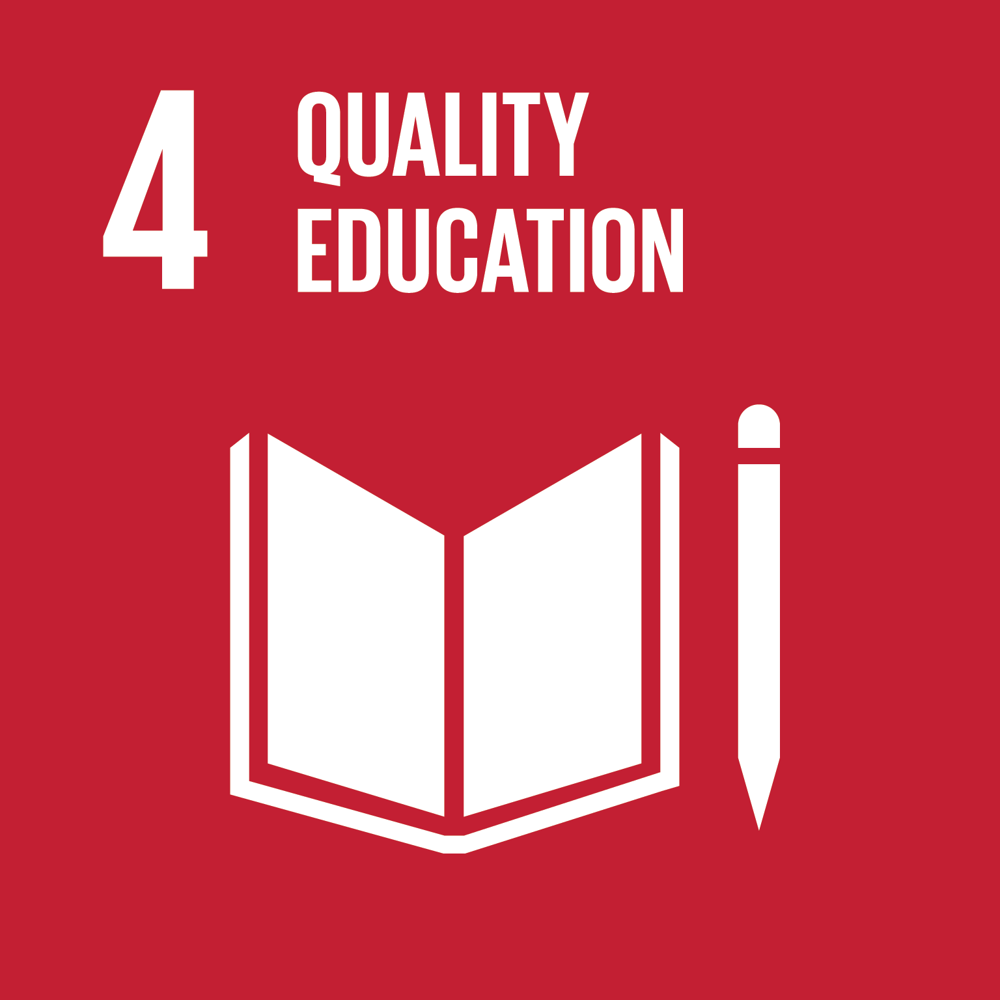

**INVOFEST 2026 · Web Design**<br/>
Tema: *Smart Ecosystems: Digital Solutions for a Sustainable Future*<br/>
Subtema: **Smart Education & Campus Innovation (SDG 4)**

Orbit **tidak menggantikan** sekolah, kampus, atau dosen. Orbit **melengkapinya**: dosen tetap mengajar, Orbit menunjukkan ke mana setiap pelajaran mengarah. Untuk kampus, **Orbit for Campus** memberi insight agregat tentang kesiapan dan gap skill mahasiswa agar bimbingan dan kurikulum bisa lebih tepat.

| Target SDG | Kontribusi Orbit |
| --- | --- |
| **4.3** Akses pendidikan berkualitas | Bimbingan belajar dan karier gratis, kapan saja |
| **4.4** Skill relevan untuk pekerjaan layak | Setiap mata kuliah dipetakan ke kebutuhan dunia kerja |
| **4.5** Mengurangi kesenjangan | Dwibahasa (ID/EN), mobile-first, tanpa biaya |

Orbit juga mendukung **SDG 8.6** (menurunkan jumlah pemuda NEET) dan **SDG 10.2** (bimbingan karier tidak lagi bergantung pada koneksi).

---

## ❗ Masalah

Di Indonesia, **7,38 juta orang menganggur** (BPS, Agustus 2026), dan **lebih dari 5 juta** di antaranya sudah lulus SMA, SMK, atau perguruan tinggi.

| Data | Artinya |
| --- | --- |
| **9,9 juta** anak muda (15–24) tidak bekerja, sekolah, atau pelatihan | Banyak yang berhenti karena tidak punya arah |
| **87%** mahasiswa merasa jurusannya tidak sesuai minat | Belajar bertahun-tahun tanpa tahu tujuannya |
| **±35%** pekerja muda bekerja tidak sesuai pendidikannya | Yang dipelajari dan yang dibutuhkan kerja tidak bertemu |
| **8,20%** pengangguran lulusan SMK, tertinggi dari semua jenjang | Pendidikan belum cukup terhubung dengan industri |
| **39%** skill inti pekerja akan berubah pada 2030 | Pelajar butuh kompas yang selalu diperbarui |

<sub>Sumber: [BPS via Katadata](https://databoks.katadata.co.id/ketenagakerjaan/statistik/6aec350368270/ada-738-juta-pengangguran-di-indonesia-pada-agustus-2026) · [BPS via CNBC Indonesia](https://www.cnbcindonesia.com/news/20261106084938-4-782835/880-ribu-sarjana-ri-masih-menganggur) · [BPS NEET](https://www.cnbcindonesia.com/research/20240515103217-128-538210/10-juta-gen-z-di-ri-nganggur-sekolah-kagak-kerja-kagak-maunya-apa) · [Indonesia Career Center Network](https://www.goodnewsfromindonesia.id/2022/04/01/penyebab-fenomena-salah-jurusan) · [CNBC Research](https://www.cnbcindonesia.com/research/20251104154304-128-682220/pendidikan-tinggi-upah-rendah-35-pekerja-muda-salah-jurusan) · [Fortune IDN](https://www.fortuneidn.com/news/provinsi-dengan-tingkat-pengangguran-tertinggi-2026-versi-bps-d7w02-00-lflgw-1qgths) · [WEF Future of Jobs 2025](https://www.weforum.org/publications/the-future-of-jobs-report-2025/)</sub>

**Kenalkan Naya**, mahasiswi Sistem Informasi yang bermimpi menjadi Product Manager. IPK-nya bagus, tetapi ia tidak tahu kelas mana yang penting, ikut-ikutan tren belajar, kewalahan mencari info magang, kehilangan semangat, lalu panik di semester akhir. Halaman **[Why Orbit](https://orbit-career-agent.vercel.app/why-orbit)** menceritakan perjalanan ini secara lengkap.

---

## 💡 Solusi: 6 Pilar Orbit

Alur penggunaannya sederhana: **Dream → Learn → Plan → Grow**.

| # | Pilar | Fitur | Yang dilakukan |
| --- | --- | --- | --- |
| 01 | **Mulai** | Build My Orbit | Tiga langkah singkat (profil, tujuan karier, skill) lalu analisis karier pertama langsung jadi |
| 02 | **Pahami** | Career Intelligence | Skor Career Readiness 0–100% dari 6 dimensi, lengkap dengan kekuatan dan gap yang sudah diurutkan |
| 03 | **Belajar** | Learning Map · Knowledge Vault | Setiap mata kuliah dipetakan ke skill dan karier. Unggah slide, catatan, tugas, atau proyek, lalu Orbit menemukan skill di dalamnya |
| 04 | **Jelajahi** | Career Universe | Peta interaktif yang menghubungkanmu dengan peran, skill, kursus, mentor, dan lowongan. Punya lebih dari satu impian? Buat beberapa orbit |
| 05 | **Rencanakan** | Journey | Roadmap bertahap dan quest mingguan (tampilan roadmap atau papan kanban) yang disusun dari gap-mu |
| 06 | **Temukan & Tumbuh** | Discover · Today · Progress · Orbit Agent | Magang, kerja, kursus, event, mentor, dan buku dengan skor kecocokan. Satu *Next Best Action* setiap hari, XP, streak, dan asisten Orbit Agent |

**Fitur pendukung:** Orbit for Campus (dasbor insight kampus) · Career Journal · notifikasi & pengingat · pencarian cepat `Ctrl/⌘ + K` · Orbit Agent (tombol `A`) · mode terang/gelap · Bahasa Indonesia & English · bisa dipasang sebagai aplikasi (PWA) · responsif di ponsel.

---

## ▶️ Coba dalam 2 Menit

Buka **[orbit-career-agent.vercel.app](https://orbit-career-agent.vercel.app)**, tanpa perlu mendaftar.

1. **Why Orbit:** lihat data masalah, cerita Naya, lalu 6 pilar solusi. Setiap pilar punya tombol untuk langsung membuka fiturnya, dan tombol kembali membawamu ke posisi terakhir di halaman.
2. **Coba demo sebagai Naya:** dari halaman utama, atau tombol *Lanjutkan dengan akun demo Naya* di halaman Masuk.
3. **Today:** ikuti panduan *Start here* (Dream → Learn → Plan → Grow).
4. **Learn:** tambahkan materi belajar, lihat skill yang ditemukan, lalu buka Learning Map untuk melihat guna setiap mata kuliah.
5. **Career Universe:** klik *Product Analytics* → **Add to Journey** → konfirmasi.
6. **Journey & Discover:** pindahkan quest di papan, simpan lowongan magang, lalu pasang pengingat.
7. **Orbit Agent:** tekan `A` dan tanya *"Apa yang harus aku lakukan berikutnya?"*

Data demo bisa direset kapan saja dari menu akun → **Reset demo data**.

---

## 🖼️ Tampilan

<table>
<tr>
<td width="50%">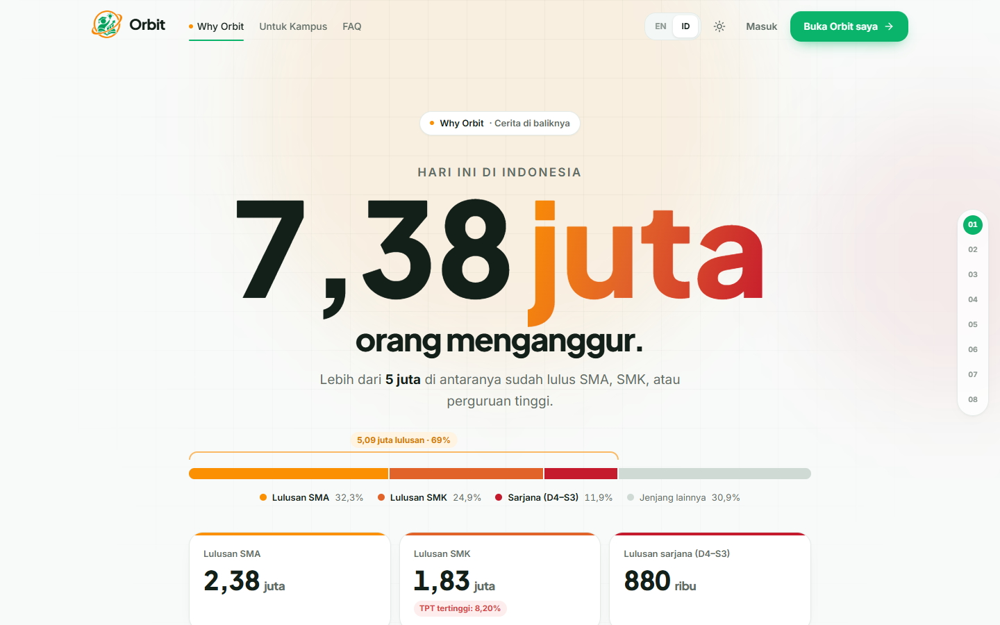<br/><sub><b>Why Orbit:</b> data, cerita Naya, dan solusi</sub></td>
<td width="50%">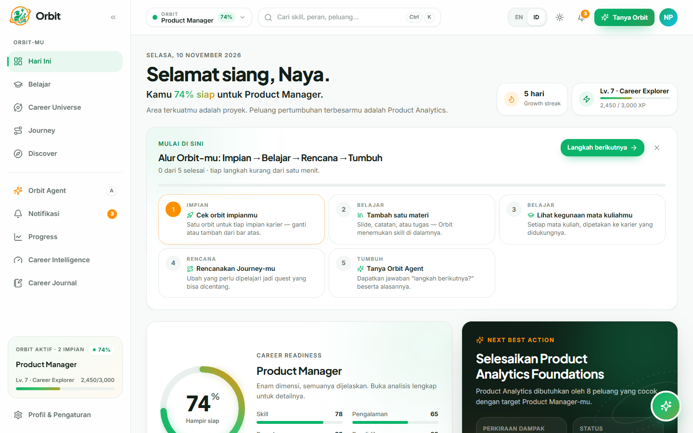<br/><sub><b>Today:</b> panduan langkah dan Next Best Action</sub></td>
</tr>
<tr>
<td>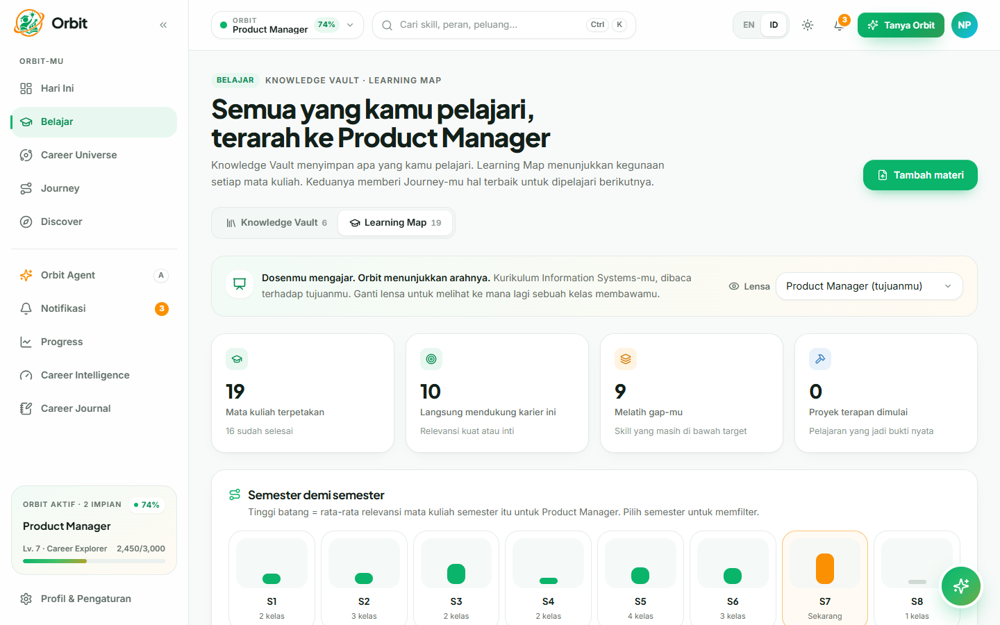<br/><sub><b>Learn:</b> Knowledge Vault & Learning Map</sub></td>
<td>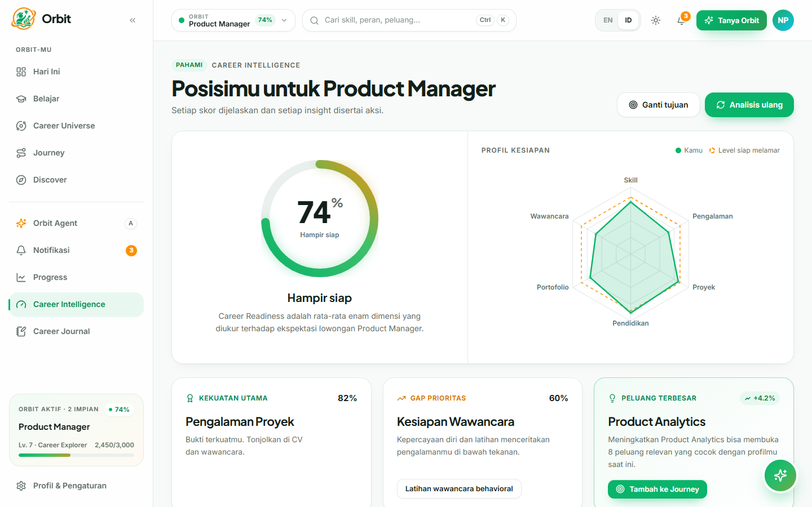<br/><sub><b>Career Intelligence:</b> kesiapan dari 6 dimensi</sub></td>
</tr>
<tr>
<td>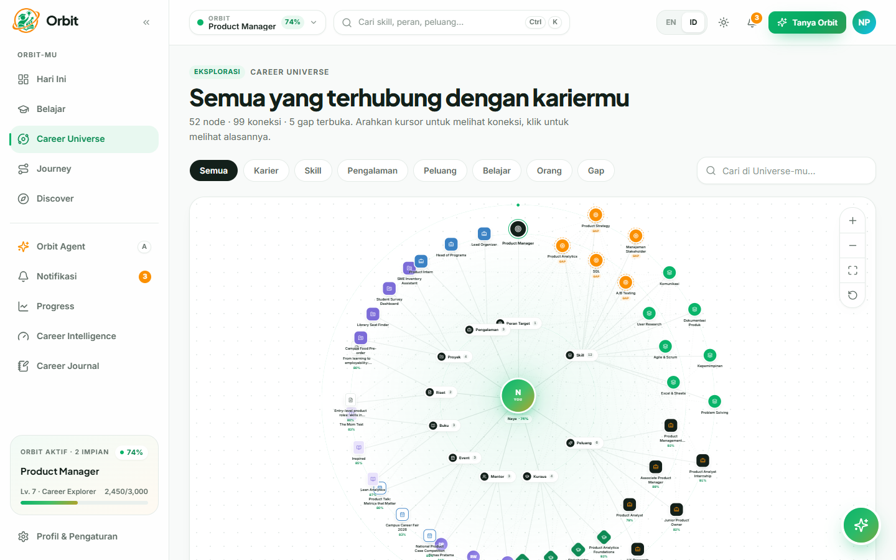<br/><sub><b>Career Universe:</b> semua yang terhubung ke kariermu</sub></td>
<td>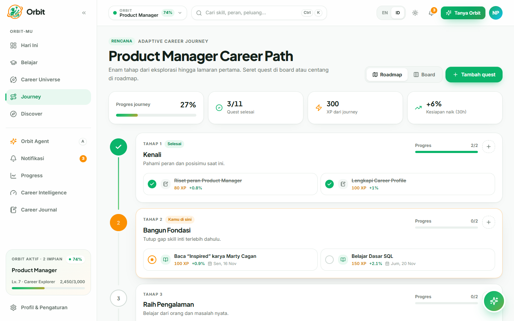<br/><sub><b>Journey:</b> roadmap dan quest mingguan</sub></td>
</tr>
<tr>
<td>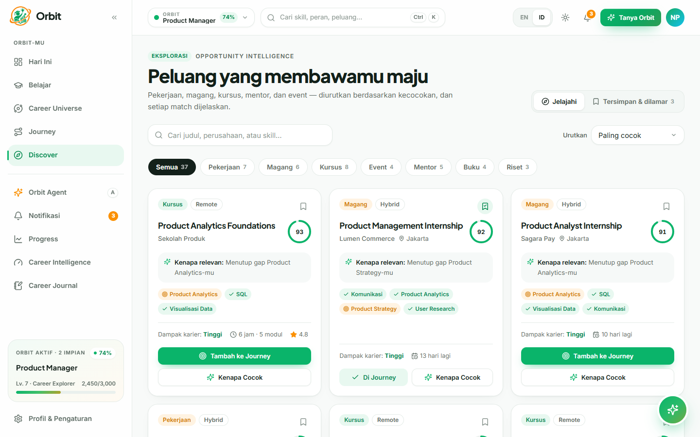<br/><sub><b>Discover:</b> peluang dengan skor kecocokan</sub></td>
<td>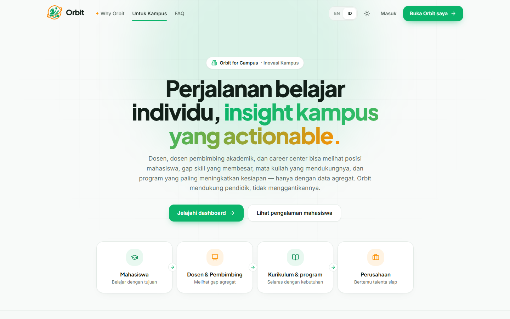<br/><sub><b>Orbit for Campus:</b> insight untuk kampus dan dosen</sub></td>
</tr>
</table>

<details>
<summary>Mode gelap</summary>
<br/>
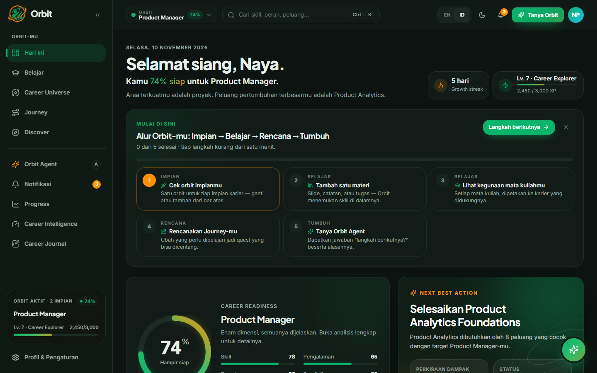
</details>

---

## 📈 Dampak & Target KPI

**Alur dampak:** pelajar belajar terarah → skill relevan sejak dini → lulusan siap kerja → pengangguran terdidik berkurang.

| Target | Ukuran |
| --- | --- |
| **+15 poin** | Career Readiness per semester aktif |
| **100%** | Mata kuliah terpetakan ke alasan karier, sejak hari pertama |
| **30 menit** | Rencana belajar mingguan (sebelumnya 3–5 jam) |
| **70%** | Pengguna menyelesaikan ≥1 quest setiap minggu (tahun 1) |
| **80%** | Pelajar tahu alasan mempelajari tiap mata kuliah (survei tahun 1) |
| **≤6 bulan** | Menuju kerja/magang pertama setelah lulus |

**Rencana skala:** Pilot 2027 (10 mitra, 10 rb pelajar) → Scale 2028 (40 mitra, 75 rb pelajar) → Nasional 2029 (100 mitra, 250 rb pelajar).

---

## 🛠️ Teknologi

| Bagian | Teknologi |
| --- | --- |
| **Framework** | React 19, Vite 6, TypeScript, React Router 7 |
| **Tampilan** | Tailwind CSS 4, Radix UI, Lucide Icons, Motion, Lenis |
| **Visualisasi** | React Flow (`@xyflow/react`), Recharts, dnd-kit |
| **State & data** | Zustand (tersimpan di `localStorage`), Zod |
| **Kecerdasan** | Engine on-device yang bisa dijelaskan: Career Intelligence, Knowledge, Universe, dan Orbit Agent (`apps/web/src/engine`) |
| **Lainnya** | PWA (`vite-plugin-pwa`), dwibahasa ID/EN, deploy di Vercel |

---

## 🚀 Menjalankan Secara Lokal

Prasyarat: **Node.js 20+** dan **pnpm 9**.

```bash
git clone https://github.com/StyNW7/Orbit-AI-Agent.git
cd Orbit-AI-Agent
pnpm install
pnpm dev        # http://localhost:5173
```

| Perintah | Fungsi |
| --- | --- |
| `pnpm dev` | Menjalankan server pengembangan |
| `pnpm build` | Build produksi ke `apps/web/dist` |
| `pnpm preview` | Melihat hasil build |
| `pnpm lint` · `pnpm typecheck` | Pemeriksaan kualitas kode |

Tidak perlu database, API key, atau file `.env`.

---

## 📁 Struktur Folder

```
.
├── apps/web/                 # Web Orbit (React + Vite)
│   ├── public/               # Ikon & aset PWA
│   └── src/
│       ├── features/         # Halaman: landing, why, learning, universe, journey, discover, campus, ...
│       ├── engine/           # Logika Career Intelligence, Knowledge, Universe, dan Orbit Agent
│       ├── data/             # Data demo (persona Naya, mata kuliah, peluang, kampus)
│       ├── components/       # Komponen UI, layout, dan Orbit Agent
│       ├── store/            # State aplikasi (Zustand)
│       └── lib/              # i18n, animasi, utilitas
├── packages/config/          # Konfigurasi TypeScript bersama
├── assets/                   # Logo, ikon SDG 4, screenshot README
├── README.md                 # Bahasa Indonesia
└── README-eng.md             # English
```

---

## 👤 Pembuat

<a href="https://github.com/StyNW7"></a>

**Stanley Nathanael Wijaya** · BINUS University

---

<div align="center">


**Orbit: dari belajar tanpa arah, menjadi lulusan yang siap berkarya.**

<sub>Dibuat untuk INVOFEST 2026 Web Design · Smart Education & Campus Innovation (SDG 4)</sub>

[⬆ Kembali ke atas](#orbit)

</div>
